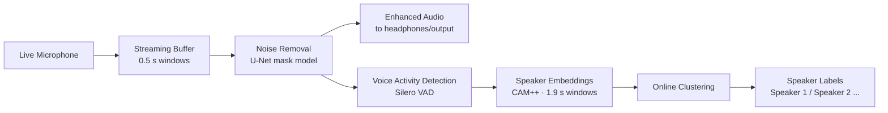

# AI-Enabled Intelligent Speech Enhancement & Communication System

> A real-time system that takes noisy live microphone audio, removes the background noise with a lightweight neural network, and labels *who is speaking*, designed to run on low-cost embedded hardware (Raspberry Pi).

**B.Tech Major Project, Electronics & Communication Engineering, JIIT Noida**
**Supervisor:** _Dr. Pankaj Yadav_ | **Academic year:** _2026-27_

---

## 1. The Problem

In real conversations (meetings, classrooms, calls, public places) speech is mixed with background noise and several people talk in turn. Two things are needed to make such audio usable:

1. **Clean the speech**, remove noise while preserving the voice.
2. **Know who is speaking**, assign each segment of speech to a speaker.

Most existing solutions run offline or need powerful GPUs. Our goal is to make this work **live, with low delay, on cheap hardware**.

## 2. What Our System Does



| Stage | What it does | Technique |
|---|---|---|
| **Speech Enhancement** | Removes noise from the incoming audio | Small U-Net that predicts a spectrogram mask (~0.48 M parameters) |
| **Streaming Inference** | Runs the model chunk-by-chunk on live audio | Fixed-size sliding windows (0.5 s) |
| **Voice Activity Detection** | Finds where speech is present | Silero VAD |
| **Speaker Diarization (online)** | Decides "who spoke when" as audio arrives | CAM++ speaker embeddings (sherpa-onnx) + online clustering |
| **Edge Deployment** | Runs on a Raspberry Pi 4/5 | ONNX export of the model *(in progress)* |

## 3. Why This Is Different From a Standard Offline Pipeline

- **Real time:** works on a live microphone stream, not recorded files.
- **Lightweight:** the enhancement model has under 0.5 M parameters, so it is small enough for embedded devices.
- **Single integrated pipeline:** enhancement and speaker labelling run together, instead of being separate offline tools.
- **Hardware prototype:** the end goal is a working prototype on a Raspberry Pi, not just a software experiment.

## 4. Datasets

| Dataset | Used for |
|---|---|
| **VCTK-DEMAND** (28-speaker version) | Training and testing the noise-removal model (noisy/clean speech pairs) |
| **RAVDESS** | Emotional speech data (1,440 files, labels CSV prepared) |

All audio is resampled to **16 kHz**.

## 5. Results So Far

### 5.1 Noise removal (full test set, 824 files)

| Metric | Noisy input | After enhancement |
|---|---|---|
| **PESQ** (perceived quality, higher is better) | 1.972 | **2.806** |
| **STOI** (intelligibility, higher is better) | 0.921 | **0.941** |
| **SI-SNR** (signal quality in dB, higher is better) | 8.44 | **18.18** |

The noise level drops substantially (about +9.7 dB SI-SNR) while intelligibility also improves.

### 5.2 Real-time behaviour

| Test | Result |
|---|---|
| Streaming vs offline quality (100 test files, 0.5 / 1.0 / 2.0 s windows) | Within about 0.03 to 0.08 dB SI-SNR of offline, so almost no quality lost by streaming |
| Compute cost on a laptop CPU (4 threads, 0.5 s window) | Real-time factor **0.065** (about 15x faster than real time) |
| Per-window compute time (p95) | about 20 to 25 ms |
| End-to-end live latency (mic to enhanced output, 0.5 s window) | about **510 ms** mean, 542 ms p95 |

### 5.3 Speaker diarization

- Speaker embeddings (CAM++) separate speakers reliably for windows up to about **2 s**, so the pipeline uses fixed **1.9 s** windows with Silero VAD and online clustering.
- On a recorded 2-speaker test, the system found both speakers with **100% accuracy**.

## 6. Project Status

| Stage | Status |
|---|---|
| Data preparation and baseline measurement | Done |
| Noise-removal model training and evaluation | Done |
| Streaming (real-time) enhancement | Done, tested live on microphone |
| Online speaker diarization | Working on recorded audio; integrating with the live pipeline |
| ONNX export and Raspberry Pi benchmark | Next |
| Final hardware prototype | Planned |

**Scope note:** the first plan included speech recognition, emotion analysis, summarisation and a dashboard. We deliberately narrowed the scope to the **live fast path** (microphone, noise removal, speaker labels) so that it can run on simple hardware. The other modules are future work.

## 7. Repository Structure

> Adjust to match the final repo layout.

```
├── setup_project.py          # creates folders / environment layout
├── preprocess_phase1.py      # resampling, baseline metrics, spectrograms
├── notebooks/
│   └── phase2_enhancement.ipynb   # model training and evaluation (Colab)
├── realtime/
│   ├── enh_infer.py          # model inference
│   ├── stream_enh.py         # streaming enhancement
│   ├── live_demo.py          # live microphone demo
│   ├── diar_stream.py        # online diarization
│   └── diar_file_test.py     # diarization test on recorded audio
├── weights/
│   └── enh_unet_best.pth     # trained enhancement model
└── samples/                  # before / after audio examples
```

## 8. How to Run

```bash
# 1. Create environment and install dependencies
python -m venv venv
venv\Scripts\activate            # Windows
pip install -r requirements.txt

# 2. Prepare data (after downloading VCTK-DEMAND and RAVDESS into data/raw/)
python preprocess_phase1.py

# 3. Live noise-removal demo from the microphone
python realtime/live_demo.py

# 4. Diarization test on a recorded 2-speaker file
python realtime/diar_file_test.py
```

Model training was done on a Google Colab T4 GPU (`phase2_enhancement` notebook).

## 9. Tech Stack

Python · PyTorch · ONNX · sherpa-onnx (CAM++) · Silero VAD · NumPy / SciPy · Google Colab · Raspberry Pi (target)

## 10. Future Work

- Finish ONNX export and benchmark on Raspberry Pi 4/5
- Reduce end-to-end latency for the hardware prototype
- Add speech recognition, emotion analysis and summarisation (offline / cloud path)
- Dashboard for visualising speakers and transcripts

## 11. Team and Acknowledgements

Priyanshu Bhardwaj 23102088
Pratham Prabhat Srivastava 23102084

**Supervisor:** Dr. Pankaj Yadav 
**Institution:** Jaypee Institute of Information Technology, Noida

Datasets: VCTK-DEMAND (University of Edinburgh DataShare), RAVDESS.
